<!--
 

     <h1>余 鹏</h1>
     

         
             
             131****8833
         
         ·
         
             
             yu3peng@qq.com
         
         ·
         
             
             <a href="https://github.com/yu3peng">GitHub</a>
         
         ·
         
             
             <a href="https://yu3peng.github.io">My Blog</a>
         
     

 

##  个人信息

- **男，1983 年，上海**

##  教育经历

- **本科，中南民族大学，计算机科学与技术专业，2003.09 ~ 2007.06**

##  **工作经历**

- **中兴通讯股份有限公司，软件架构师，2011.07 ~ 今**
  - 设计基于 Kubernetes 的 GPU 共享方案，实现 GPU 在容器间的共享和显存限制

  - 设计边缘拉远方案

  - 向 ETSI NFV、CCSA 等国内外标准组织输出基于云原生的 PaaS 提案

  - 开发边缘网关配置服务网站

  - 按照 3GPP 协议开发 4G 核心网 Serving Gateway 网元

- **备实必（上海）软件科技有限公司，软件开发工程师，2009.12 ~ 2011.06**

  - 维护作业调度自动化软件 A-AUTO

- **广东华智科技有限公司，软件开发工程师，2007.09 ~ 2009.10**

  - 儿童抚养补助系统数据批处理程序开发

##  专利

- **[一种调整网站负载的方法及装置](http://epub.cnipa.gov.cn/cred/CN109005143B?8kt2YOWWXQBD=1648781983435)**

- **[Method and device of regulating website load](https://image-ppubs.uspto.gov/dirsearch-public/print/downloadPdf/11405384)**

- **[一种业务配置的实现方法、装置和设备](http://epub.cnipa.gov.cn/patent/CN111865638A?8kt2YOWWXQBD=1650543953261)**

- **[一种资源请求响应方法、设备及存储介质](http://epub.cnipa.gov.cn/patent/CN110737527A)**

- **[无线接入设备注册方法及装置](http://epub.cnipa.gov.cn/patent/CN106817699A?8kt2YOWWXQBD=1650544728649)**

- **[检测非法无线接入点的方法及装置](http://epub.cnipa.gov.cn/patent/CN107708118A?8kt2YOWWXQBD=1650544870147)**
-->
<!--

-->

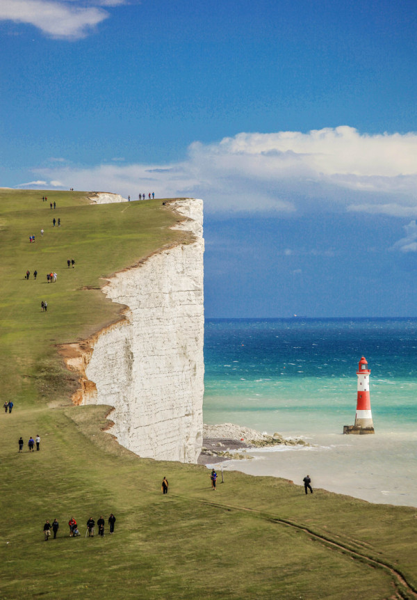

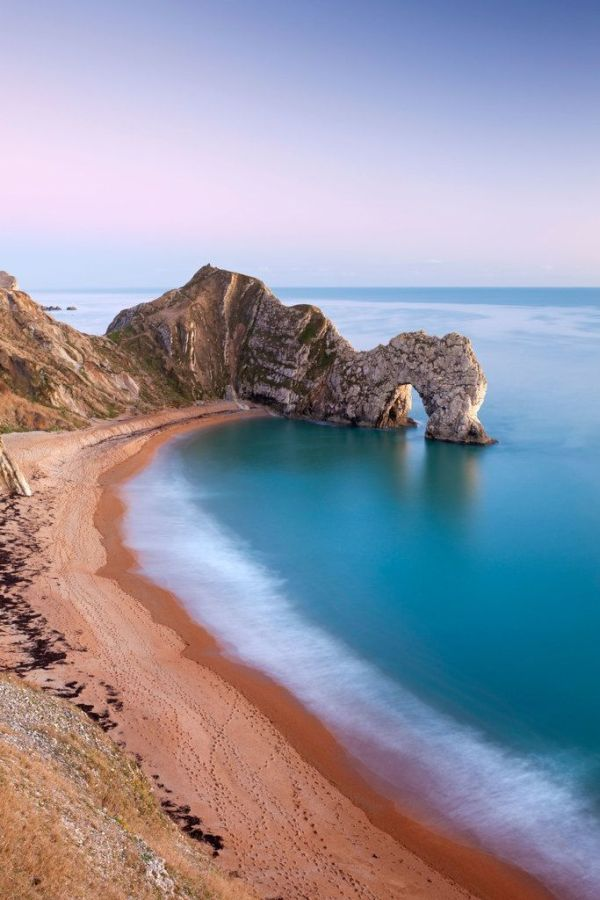

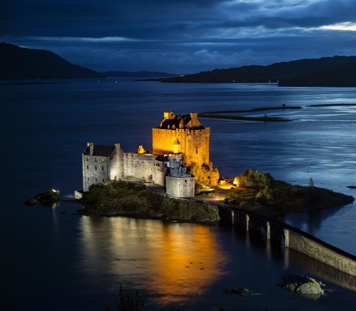

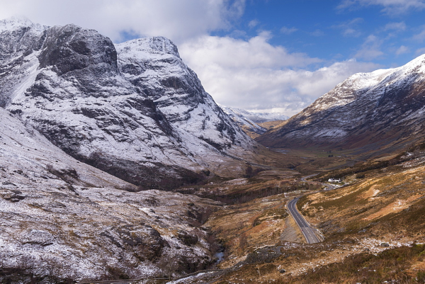

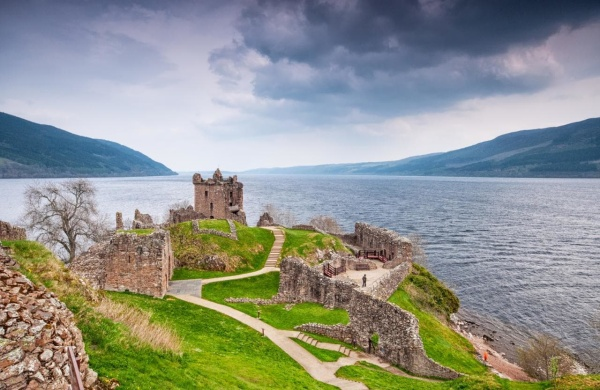

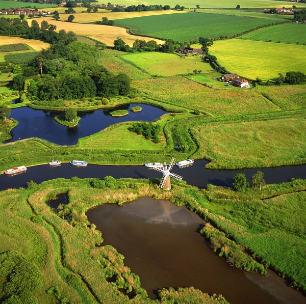

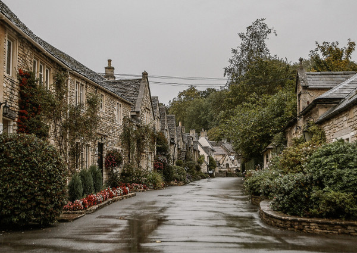

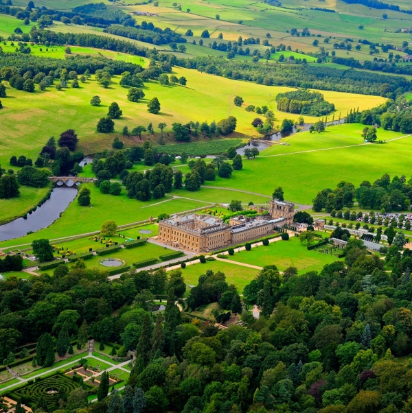

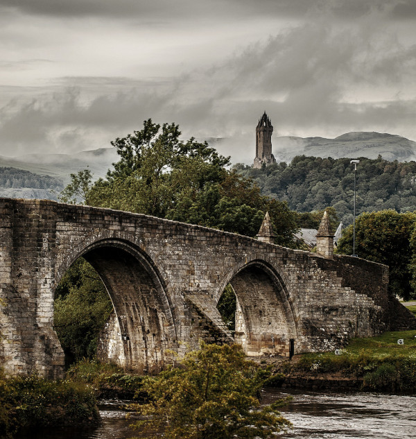

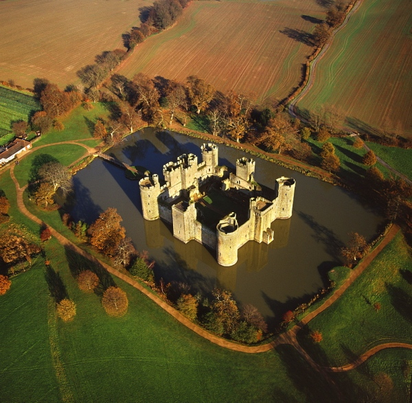

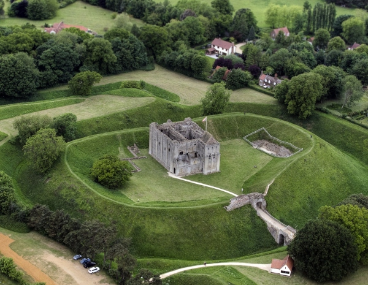
